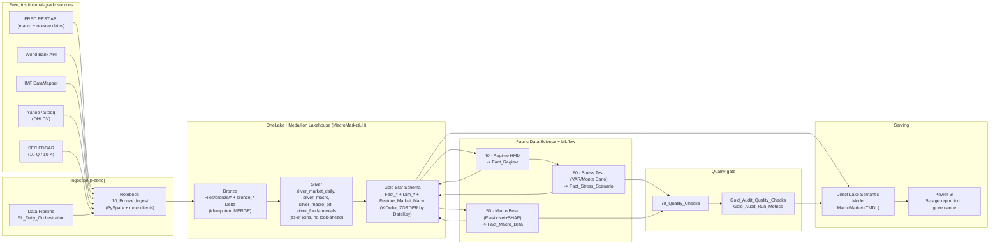

# Architecture & Data Lineage

## End-to-end flow

## Layer responsibilities

| Layer | Items | Guarantees |
|-------|-------|-----------|
| **Bronze** | `Files/bronze/<source>/ingestion_date=.../`, `bronze_fred`, `bronze_market`, `bronze_world_bank`, `bronze_imf`, `bronze_sec_edgar` | Immutable raw copy + idempotent `MERGE` on natural keys (no duplicates on re-run). Audit columns `_source`, `_ingestion_date`, `_ingested_at`. |
| **Silver** | `silver_market_daily`, `silver_macro`, `silver_macro_pit`, `silver_fundamentals` | Adjusted-close returns, winsorized bad ticks, rolling vol; macro YoY/MoM; **release/filing-date as-of joins** → zero look-ahead bias; trading-day alignment. |
| **Gold** | Star schema facts/dims + ML outputs + `Gold_Audit_Quality_Checks`, `Gold_Audit_Run_Metrics` | Clean star schema, V-Order + `OPTIMIZE ZORDER BY (DateKey)` for Direct Lake; audit tables for governance reporting. |

## Key design decisions (why this is senior-level)

1. **Point-in-time correctness.** FRED is pulled with `output_type=4` (initial release) so each
   observation carries its *first publication date*. Market rows only ever see macro values
   already released — enforced by `merge_asof(direction="backward")` and the Spark forward-fill
   on `effective_date`. Proven by `tests/test_asof_and_transforms.py`.
2. **Mixed-frequency handling.** Monthly/quarterly macro is never interpolated with future values;
   it is forward-filled strictly from the release date and aligned to the next trading day.
3. **Idempotency.** Every Bronze write is a keyed Delta `MERGE`, so pipeline re-runs and backfills
   are safe.
4. **Direct Lake, not import.** The semantic model reads Gold Delta directly (no data duplication,
   low latency), which is the whole point of the Fabric serving layer.
